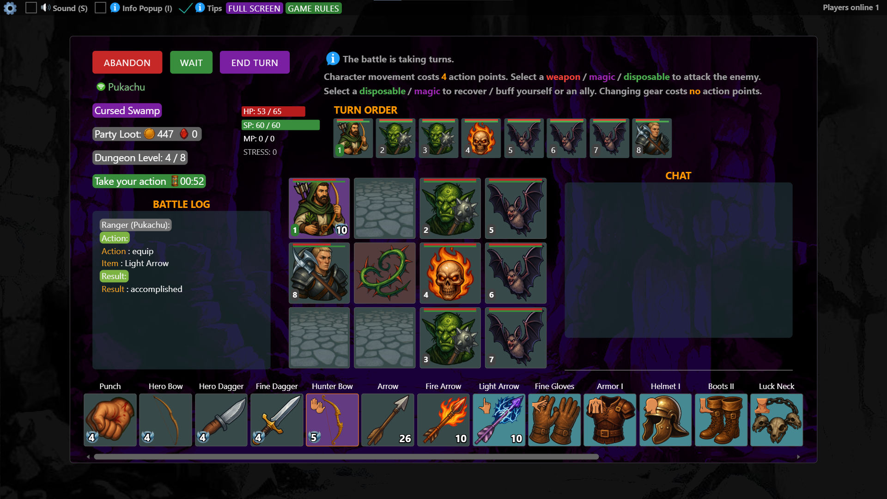

# 地牢探险：网页客户端

这是与 [Go 服务端](https://github.com/LearnedYet/Dungeon-Adventure-Server)配套的概念验证网页游戏客户端。服务端仓库目前为私有仓库。

客户端负责显示游戏画面、接收玩家操作，并与 Go 服务端通信；游戏规则的判断与状态计算由服务端完成。它与 `Dungeon-Adventure-Server` 是同一个游戏的前后端，需要配合运行。

## 在线试玩

**[打开「地牢探险」汉化版](https://learnedyet.github.io/Dungeon-Adventure-Client/)**

使用 Google 账号登录，首次进入时填写昵称并选择职业，即可创建角色。

2026 年 10 月 28 日已由维护者手动验证：Google 登录、实际游戏流程，以及关闭游戏后使用同一账号重新登录，角色和进度仍然保留。

## 当前运行条件

这是临时演示入口。网页由 GitHub Pages 托管，Go 服务端和 MongoDB 运行在维护者的电脑上，通过临时隧道提供游戏接口。

- 电脑、网络、Go 服务端、MongoDB 和隧道需要保持运行；本机网络代理也影响 Google 登录。后台停止时，网页可能仍能打开，但无法正常进入游戏。
- 重新建立临时隧道后，后端地址可能变化，届时需要更新 Google 回调和前后端配置，并重新发布网页。
- 当前已验证维护者的 Google 账号；其他账号仍可能受 Google OAuth 测试用户设置限制。

## 阅读说明

本地启动配置、Google 凭据和运行记录保存在仓库之外。代码中的标识符、协议字段、命令及资源路径保留原文，以维持程序兼容。

